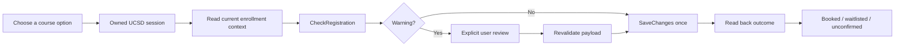

# TSS Better Booking

A self-hosted course-booking interface for UC San Diego's Triton Student System. Organize course options by profile, sign in to your own UCSD account, and submit a verified package without repeating catalog and booking-page navigation.

**Independent prototype. Not affiliated with or endorsed by UC San Diego.** TSS still controls authentication, eligibility, availability, and enrollment. This is an adapter for an observed TSS implementation, not a universal university booking connector or an outage bypass.

Start with [the plain-English explanation](docs/PLAIN_ENGLISH.md), with expandable notes for the technical terms.


## Try the template

Requires Node.js 22.23.4+ and npm. Use Node 24 for the same major version as the CI template and the benchmark.

```sh
npm ci
npm test
npm run build
npm run preview
```

Open the local preview's `/booking/` page. The example shows **King Triton, Person 2, and Person 3**, with illustrative courses. It makes no TSS requests and cannot book anything.

Optional GitHub Actions: copy `ci/verify.yml` to `.github/workflows/verify.yml` in your repository using an account with workflow-write permission. This runs the same checks on pushes and pull requests; it does not deploy anything. The published template has no active workflow.

## Ask an agent to build your instance

Point an agent with repository, terminal, and browser access at this repository:

> Read AGENTS.md, docs/AGENT_SETUP.md, and docs/DEPLOYMENT.md. Build a separate deployment for my course plans. Keep local configuration out of Git and booking disabled. Run the local tests, show me the preview, then validate hosted authentication and exact route payloads read-only. Let me perform UCSD/Duo sign-in myself. Do not enroll, drop, or retry an uncertain submission. Report evidence and unresolved limits before enabling booking.

The agent can implement and deploy the site. You still supply your hosting account, course choices, and interactive UCSD/Duo authentication. No bookmark or browser extension is needed.

## What's included

- Responsive profile/course lists, meeting details, surf loading motion, and reduced-motion support.
- An account-name connection indicator based on the authenticated session, independent of the selected profile.
- Isolated, short-lived hosted browsers; same-origin APIs and explicit usage limits.
- Exact server-owned route allowlists and a separate per-route validation gate.
- Direct `CheckRegistration` → warning review if needed → one `SaveChanges` request.
- Read-back confirmation distinguishing booked, waitlisted, and unconfirmed results.
- Deterministic security/session tests, synthetic browser fixtures, and a reproducible baseline benchmark.



## Configure and host

Start with `config.example.json`; copy it to the ignored `config.local.json`. The generator produces the public course data, server allowlist, and local deployment configuration from that one file. The default has no trusted routes, and direct booking is off.

The template deploys static assets and its API on one Cloudflare Worker origin, with Browser Run and Durable Objects. See [deployment](docs/DEPLOYMENT.md), [configuration](docs/CONFIGURATION.md), and [route validation](docs/VALIDATION.md).

**Profile names and course lists become public site content when deployed.** Use aliases or information participants explicitly want displayed. Ignoring a local configuration file prevents a Git leak; it does not make the generated website private.

## Evidence and limits

See [the baseline report](docs/BENCHMARK.md) for measured public HTTP timing and separately labeled synthetic booking-path timing. It is not a live enrollment speed test, a campus rush-load test, or a comparison proving this is faster than the official site. Template extraction is tested separately from that baseline.

Backend outages remain possible. A submission can succeed even if its response is lost, so an unknown result is never automatically retried. Hosting capacity, session lifetimes, and provider quotas also apply.

The provider runs a controlled browser session, so its operator is trusted with that session. There is no credential database, cookie export, or recording in this application. Read the [security model](SECURITY.md) before hosting for anyone else.

## Project files

| Path | Purpose |
| --- | --- |
| `src/` | Static Astro interface and session client |
| `workers/booking/src/` | Session ownership, request guard, and TSS adapter |
| `workers/booking/test/` | Synthetic backend tests |
| `config.example.json` | Nonpersonal example configuration |
| `scripts/` | Configuration, checks, benchmark, and deployment helpers |
| `docs/` | Agent setup, deployment, validation, and evidence |

MIT-licensed project code. Dependency licenses remain their own. No university application bundles, captured login pages, session data, or proprietary fonts are included.
